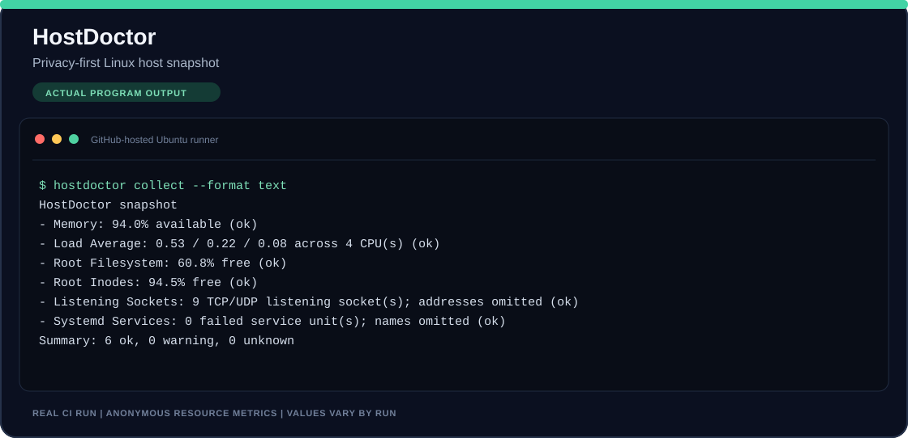

# HostDoctor

## Live demo

Live run from GitHub-hosted Ubuntu. Resource figures change between runs; this is an ephemeral runner snapshot, not production telemetry.

HostDoctor creates a read-only first-response snapshot for Linux hosts. It checks memory, load, root filesystem and inode capacity, listening socket count, and failed systemd services, then emits text or JSON with threshold-based exit codes.

## Privacy defaults

HostDoctor does not read journal logs, process command lines, user files, or application data. It does not upload anything. Reports omit hostnames, IP addresses, mount paths, process names, and failed unit names. The socket check uses ss without process details and retains only the number of listening sockets.

The command reads selected counters from procfs, checks root filesystem usage, and asks systemd for its failed service list. It never changes a host. Run it with ordinary user permissions; a check unavailable to that user is reported as unknown.

## Install

Requires Python 3.11 or later on Linux.

~~~shell
python -m pip install .
~~~

## Usage

~~~shell
hostdoctor collect
hostdoctor collect --format json
hostdoctor collect --disk-warn-below 15 --memory-warn-below 12 --fail-on warning
~~~

Default exit code is 0. With fail-on warning, exit code 1 means at least one threshold was crossed; 2 means the platform or arguments are unsupported. Unknown checks do not fail the run.

For development, install the pinned test tools with `python -m pip install --require-hashes -r requirements-dev.lock`, then install the checkout with `python -m pip install --no-deps --no-build-isolation -e .`.

## Example output

~~~text
HostDoctor snapshot
- Memory available: 42% (ok)
- Root filesystem free: 31% (ok)
- Root inode free: 87% (ok)
- Load average: 0.42 / 0.37 / 0.31 across 4 CPU(s) (ok)
- Listening TCP/UDP sockets: 7 (ok; addresses omitted)
- Failed systemd services: 0 (ok)
~~~

The sample uses synthetic values. Actual report values vary by host.

## Development

~~~shell
python -m pytest -q
~~~

Tests use synthetic procfs text, fake command results, and injected filesystem readings. GitHub Actions tests on Ubuntu with Python 3.11 and 3.12.

## Limits

- Linux only. HostDoctor does not install monitoring agents or maintain history.
- A failed systemd query or unavailable procfs metric is reported as unknown, not healthy.
- It does not inspect service logs, application health endpoints, network routes, or database state.
- Thresholds are simple operator-configurable warnings, not an SLO or production observability platform.

## Project structure

- hostdoctor/collect.py — data collection and safe command invocation.
- hostdoctor/parsers.py — procfs and ss parsers.
- hostdoctor/report.py — status calculation and output.
- hostdoctor/cli.py — command-line interface.

## License

MIT. See the included LICENSE file.
